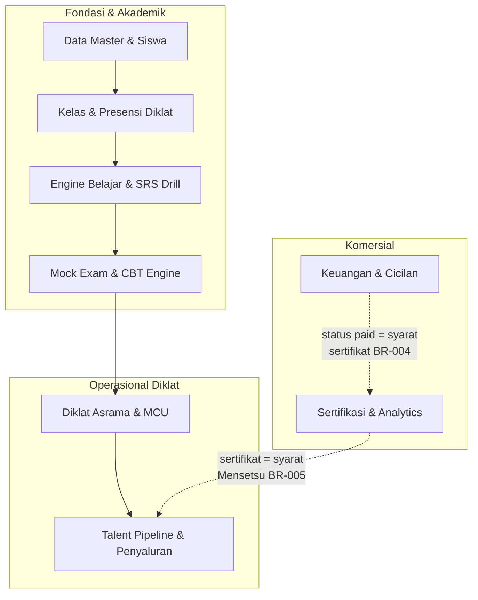

# Product Requirements Document (PRD)
## JLPT Academy — Sistem Terintegrasi LPK & Sending Organization (SO) Jepang

| Parameter | Spesifikasi |
|---|---|
| **Nama Produk** | JLPT Academy (Sistem 3-in-1: LMS Drill Ujian + ERP Diklat & Karantina + Talent Pipeline) |
| **Versi Dokumen** | v0.3 (Analysis Baseline — Sinkron `question-framework.md` FINAL) |
| **Status** | Draft Analisis / Menunggu Audit §5c |
| **Kategori Launch** | Persiapan bahasa Jepang (JLPT N5–N1 & JFT-Basic A2) → Diklat/Karantina → Penyaluran Kerja ke Jepang |
| **Model Operasi** | LPK & Sending Organization (SO) **berizin Kemenaker** (Ditjen Binalavotas) — 3-in-1 terintegrasi |
| **Target Skala** | 300–500 siswa aktif simultan → 2.500+ siswa/tahun (4–6 batch/tahun) |

> **Peta baca:** `README.md` = pengantar repo (apa ini, untuk siapa, struktur dokumen, urutan baca). **PRD ini = spesifikasi produk lengkap** — persona, ruang lingkup, state machine, business rules, data model, NFR, tech stack.

---

## 1. Executive Summary & Problem Statement

### 1.1 Latar Belakang & Masalah Bisnis
Perjalanan calon tenaga kerja Indonesia menuju Jepang (jalur **Magang 3 Tahun / Technical Intern** & **SSW I–II**) melibatkan rentetan proses panjang: pendaftaran, drill bahasa, ujian JLPT/JFT, karantina asrama, MCU, matching Kumiai/Kaisha, sampai COE, visa, dan keberangkatan. Lembaga LPK/SO yang mengelola proses ini umumnya menghadapi kegagalan sistem berikut:

1. **Data Tercecer & Manual:** Siswa, kelas, ujian, pembayaran, asrama, dan status kerja dikelola di tempat terpisah (buku tulis, spreadsheet, chat) — menyulitkan audit Kemenaker & Imigrasi Jepang.
2. **Perjalanan Karir Tak Terotomasi:** Tahapan MCU → diklat → ujian → matching → COE → visa → berangkat tidak transparan; siswa tidak tahu posisinya, staf harus telusuri manual.
3. **Risiko Keuangan Tak Terstruktur:** Biaya besar (SPP, asrama, dokumen) bergantung pada cicilan & talangan — tanpa skema DP/dormant/angsuran terstruktur, penagihan sulit dilacak.
4. **Reputasi Bergantung Integritas Penyaluran:** Nilai jual lembaga adalah **zero-kabur / zero-deserter** — butuh bukti terdigitalisasi bahwa setiap siswa benar-benar berangkat dan terlacak.

### 1.2 Tujuan Produk (Product Goals)
Membangun sistem operasional lembaga yang terintegrasi dan auditabel, menjamin keandalan perjalanan siswa dengan prinsip:

* **End-to-End Traceability:** Setiap tahap (daftar → belajar → uji → karantina → berangkat) tercatat dengan jejak audit lengkap.
* **Zero-Deserter:** Integritas penyaluran dijaga lewat pipeline Kanban yang hanya bisa digerakkan staf berwenang + log audit permanen.
* **Gate-Based Progression:** Perpindahan tahap dikunci gerbang keras — MCU **Fit** (BR-006), lulus ujian (BR-003), dan biaya **lunas** (BR-004).
* **Mobile-First Accessibility:** Siswa (mayoritas HP Android, literasi menengah–bawah) bisa belajar & drill mandiri dari daerah, termasuk mode offline.
* **Regulatory Compliance:** Kepatuhan penuh **UU PDP No. 27/2022** & legalitas LPK-SO Kemenaker.

---

## 2. Tujuan Bisnis & Success Metrics (G1–G6)

| ID | Tujuan Bisnis | Tipe | Metrik (baseline → target) | Penilai |
|----|---------------|------|----------------------------|---------|
| **G1** | Meluluskan siswa yang lolos ujian bahasa | Service | Pass rate ujian bahasa → **≥ 85%** | Owner |
| **G2** | Menyukseskan penyaluran kerja | Service | Siswa **berangkat kerja → 200+ /tahun**; gagal wawancara/batal berangkat → **< 5%** | Owner + Staff SO |
| **G3** | Pertumbuhan & skala lembaga | Revenue | Siswa aktif simultan → **300–500**, kapasitas scale ke **2.500+/tahun**; 4–6 batch/tahun | Owner |
| **G4** | Integritas & reputasi (zero-kabur) | Intangible | **Zero-deserter**; akreditasi **A Kemenaker** | Owner |
| **G5** | Efisiensi operasional | Revenue | Administrasi (absensi, tagihan, berkas) otomatis → waktu admin turun **≥ 50%** | Admin Keuangan/TU |
| **G6** | Kepatuhan regulasi | Legal | Insiden data pribadi = **0**; kepatuhan **UU PDP No. 27/2022** & legalitas LPK-SO Kemenaker | Owner |

**Tujuan bisnis ↔ modul:** G1 → F3/F4 · G2 → F6 · G3 → F1/F6 · G4 → F6 · G5 → F2/F7 · G6 → lintas modul.

---

## 3. User Persona & Matriks Hak Akses (RBAC)

Sistem mendukung **6 aktor utama** dengan otorisasi terpisah, ditambah kanal data dari mitra eksternal Jepang:

| Role | Target Pengguna | Akses & Perangkat | Hak Akses Utama |
|---|---|---|---|
| **Siswa Diklat** | Calon magang/SSW, usia 18–30 | **Mobile-First (Android)**; web saat lab CBT | Belajar/drill, mock exam, absensi QR, pantau tahapan dokumen, cek & bayar tagihan |
| **Sensei / Pengajar** | Guru bahasa & penyusun materi | HP / laptop | Input kehadiran & nilai **< 3 ketukan**, kelola materi + bank soal via CMS |
| **Pembina Diklat & Asrama** | Fasilitator karantina & kedisiplinan | HP | Absensi Apel Pagi/Tenko, rekam kesamaptaan fisik, log pelanggaran |
| **Staff Matching & Penyaluran (SO)** | Pengelola matching & dokumen ke Jepang | Laptop | Gerakkan Kanban pipeline, generate Rirekisho, kelola COE/visa |
| **Admin Keuangan / TU** | Pengelola tagihan, pembayaran, berkas | Laptop | Invoice per kategori, rekonsiliasi PG, verifikasi berkas siswa |
| **Pimpinan Lembaga (Owner/Direktur)** | Pengambil keputusan strategis | Laporan | Dasbor analitik: pass rate, jumlah berangkat, kinerja guru |
| **Mitra Jepang (Kumiai/TSK/Kaisha)** | *via* Staff SO / portal ringan | — | Kirim status wawancara (*Goukaku* / tidak) & dokumen (IF-04) |

---

## 4. Ruang Lingkup Fitur (Functional Scope)



### 4.1 Modul Data Master & Siswa *(Tahap 1)*
* **Manajemen Akun 6 Peran:** Siswa, Sensei, Pembina, Staff SO, Admin Keuangan, Pimpinan.
* **Profil Siswa Lengkap:** NIK, TTL, golongan darah, kontak darurat (ortu/wali), status MCU, alokasi kamar asrama, jalur karir, riwayat pendidikan, dokumen Paspor/KTP.
* **Data MCU & Asrama:** Status kelayakan fisik (`fit`/`unfit`/`ulang`), kamar & karta piket.

### 4.2 Modul Kelas & Presensi Diklat *(Tahap 1)*
* **Jadwal Mengajar:** Hari, jam, ruang, atau link Zoom/Google Meet (IF-05).
* **Presensi QR 2 Moda (BR-011):** `absensi_akademik` (per kelas) & `absensi_apel` (Apel Pagi / Tenko malam) — terpisah.
* **Buku Log Kedisiplinan:** Catatan pelanggaran + tindakan pembina.
* **Generator Rekap:** Excel & PDF siap cetak per batch (C4).

### 4.3 Modul Engine Belajar & SRS Drill *(Tahap 2)*
* **Materi per Level:** Kanji (*kaki/yomi*, stroke order), Kosakata (*goi*), Tata Bahasa (*bunpou*), Audio Listening (*choukai*), Modul Etika Kerja & 5S.
* **Flashcard Spaced Repetition:** State kartu `baru`/`belajar`/`sulit`/`dikuasai` + jadwal `next_review`.
* **Offline Caching (NFR-07):** Flashcard & audio materi aktif disimpan lokal di HP siswa.

### 4.4 Modul Mock Exam & CBT Engine *(Tahap 2)*
* **Bank Soal Modular:** 12 tipe soal sesuai kisi-kisi resmi JLPT (N5–N1) & JFT-Basic A2; audio stream; bobot nilai; indikator kesulitan.
* **Timer Adaptif per Section (BR-002):** Auto-submit saat waktu habis; session di-cache Redis.
* **Scoring Otomatis (BR-003):** Lulus hanya bila **total ≥ ambang level** DAN **tiap section ≥ ambang sectional**.
* **Analitik Kelemahan:** Identifikasi materi lemah → rekomendasi drill (→ modul 4.3).
* **CMS Terpisah (NFR-09):** Guru konten update soal tanpa ganggu modul siswa.

### 4.5 Modul Diklat Asrama & MCU *(Tahap 3)*
* **Manajemen Asrama:** Alokasi kamar, karta piket, kapasitas 150–300 siswa serentak.
* **Kesamaptaan Fisik:** Rekam push-up/lari sebagai catatan pembinaan.
* **Status MCU Akhir:** Gerbang `fit` → buka akses pipeline (BR-006).

### 4.6 Modul Talent Pipeline & Penyaluran *(Tahap 3)*
* **Kanban 11 Tahap:** `screening_mcu` → `diklat_bahasa` → `lulus_ujian` → `siap_matching` → `panggilan_mensetsu` → `lolos_interview` → `ttd_kontrak` → `pengajuan_coe` → `coe_terbit` → `visa_issued` → `tiket_berangkat`.
* **Audit Trail (BR-008):** Perpindahan kartu hanya staf berwenang; catat `staff_user_id`, tanggal, catatan.
* **Auto-Rirekisho:** Generator CV standar JIS 1-klik untuk dikirim ke Kumiai/TSK (IF-04).
* **Sinkron Status Mitra:** Portal ringan untuk menerima hasil wawancara (*Goukaku*).

### 4.7 Modul Keuangan & Cicilan *(Tahap 4)*
* **Invoice per Kategori:** `bahasa`, `asrama_makan`, `ujian`, `visa`.
* **3 Skema Bayar Wajib (BR-012):**
  * `lunas` — bayar penuh sekaligus.
  * `dp_angsuran` — bayar **DP** di muka, sisanya dijadwalkan per bulan di `jadwal_cicilan`.
  * `dormant_indent` — **indent / layanan belum datang**: tagihan ditahan, pengingat jatuh tempo dinonaktifkan sampai layanan aktif.
* **Payment Gateway (IF-01):** VA (BCA/Mandiri/BNI/BRI) & QRIS, rekonsiliasi otomatis.
* **Fallback Manual (D7):** Unggah bukti transfer + verifikasi 1-klik admin saat PG down.
* **Dana Talangan Multi-Sumber (A4):** `koperasi_mitra`, `internal_lpk`, `donasi_pemerintah`, `mitra_lain`.

### 4.8 Modul Sertifikasi & Analytics *(Tahap 4)*
* **E-Sertifikat Ber-QR:** PDF ber-watermark + `nomor_seri` UNIQ + QR menuju laman verifikasi publik.
* **Syarat Penerbitan (BR-004):** Modul selesai **DAN** mock lulus **DAN** invoice `paid`.
* **Bukti Jam Belajar (BR-005):** 150–300 jam — syarat kelayakan Mensetsu & Imigrasi.
* **Dasbor Pimpinan:** Pass rate, kinerja guru, jumlah berangkat, utilisasi asrama.

---

## 5. State Machine Pipeline Penyaluran

Perpindahan tahap dikelola sebagai *finite state machine* dengan **gerbang keras** — tidak boleh melompati syarat:

| Status Asal | Event Pemicu | Status Tujuan | Keterangan & Aksi Sistem |
|---|---|---|---|
| `[*] (Baru)` | Siswa memenuhi gerbang BR-006 + BR-004 | `screening_mcu` | MCU Fit + lulus ujian → pipeline dibuka. |
| `screening_mcu` | Staf SO konfirmasi berkas MCU lengkap | `diklat_bahasa` | Memulai fase diklat bahasa intensif. |
| `diklat_bahasa` | `mock_exam.result = 'lulus'` | `lulus_ujian` | Lulus total + sectional (BR-003). |
| `lulus_ujian` | Sertifikat internal terbit (BR-004) | `siap_matching` | Layak masuk antrean penempatan. |
| `siap_matching` | Kumiai/TSK kirim pemanggilan | `panggilan_mensetsu` | Jadwal wawancara kerja ditetapkan. |
| `panggilan_mensetsu` | Hasil wawancara = **Goukaku** | `lolos_interview` | Gagal (*Shippai*) → kembali pendampingan batch berikutnya. |
| `lolos_interview` | Kontrak kerja ditandatangani | `ttd_kontrak` | Kewajiban & penempatan disepakati. |
| `ttd_kontrak` | Dokumen diajukan ke otoritas | `pengajuan_coe` | Certificate of Eligibility dikirim. |
| `pengajuan_coe` | COE disetujui | `coe_terbit` | Menunggu pengurusan visa. |
| `coe_terbit` | Visa diterbitkan | `visa_issued` | Tiket disiapkan. |
| `visa_issued` | Siswa berangkat | `tiket_berangkat` | Menjadi **alumni**; terminal state (zero-deserter). |

> ⚠️ **Inkonsistensi terdeteksi (belum diputuskan):** baris pertama mensyaratkan **BR-004 (biaya lunas + lulus ujian)** untuk *masuk* `screening_mcu`, padahal BR-004 baru dipakai di transisi `lulus_ujian → siap_matching` (baris 4) dan `lulus_ujian` baru tercapai di baris 3. Gerbang di baris 1 diduga dobel/mendahului — lihat §11 Open Questions.

---

## 6. Business Rules Utama

> Rincian 12 BR + level enforcement ada di `docs/analyst/business-rules.md`. Bagian ini menyorot yang paling menentukan desain.

### 6.1 Gerbang Lintas Chapter (paling kritis)

| BR | Aturan | Efek |
|----|--------|------|
| **BR-004** | Sertifikat terbit hanya bila **modul selesai + mock lulus + biaya lunas** | **MENGAITKAN BAB-8 ↔ BAB-4 ↔ BAB-7** |
| **BR-006** | Siswa wajib **MCU dinyatakan Fit** sebelum matching/penyaluran | **MENGAITKAN BAB-5 ↔ BAB-6** |
| **BR-003** | Lulus = total ≥ ambang level **DAN** tiap section ≥ ambang sectional | BAB-4 |
| **BR-005** | Sertifikat = syarat Mensetsu + bukti jam belajar **150–300 jam** | BAB-8 ↔ BAB-6 |
| **BR-008** | Perpindahan pipeline hanya oleh **Staff SO/Pembina**, setiap pindah wajib tercatat | BAB-6 |

### 6.2 Tiga Skema Bayar (BR-012 — wajib dukung DP, Dormant, Angsuran)

| Skema | `skema_bayar` | Perilaku |
|-------|---------------|----------|
| **Lunas** | `lunas` | Bayar penuh sekaligus → invoice `paid` |
| **DP + Angsuran** | `dp_angsuran` | Bayar **DP** di muka; sisanya dijadwalkan per bulan di `jadwal_cicilan`. **DP/cicilan berjalan belum cukup** untuk terbit sertifikat (BR-004) |
| **Dormant / Indent** | `dormant_indent` | Layanan **belum datang** → tagihan ditahan, pengingat jatuh tempo **dinonaktifkan** (`dormant_mulai`, `dormant_alasan`) |

### 6.3 Data & Kepatuhan

* **BR-007** — data pribadi wajib terenkripsi & bisa dihapus atas permintaan (**UU PDP No. 27/2022**); peserta gugur screening → *soft delete*; data sensitif dihapus permanen setelah 1 tahun.
* **BR-009** — data siswa disimpan **10 tahun** (audit Kemenaker & Imigrasi).
* **BR-011** — presensi **2 moda terpisah**: `absensi_akademik` (per kelas) vs `absensi_apel` (Apel Pagi / Tenko malam).

### 6.4 Field Turunan (keputusan Check 1 §5c)

`invoice.sisa_tagihan` dan `mock_exam.skor_total` **dipertahankan** tetapi ditandai **`←COMPUTED`** — dihitung sistem, **bukan input manual**. Disimpan untuk optimasi query laporan; seluruh tulis/ubah wajib melewati validasi kalkulasi agar tidak kontradiksi dengan field dasarnya.

---

## 7. Data yang Dimodelkan

**41 entitas dalam 11 blok** (`docs/analyst/00-Global/ERD-MASTER.md`), didampingi `DATA-DICT-MASTER.md` (kamus makna tiap field) dan `GLOSSARY.md` (47 istilah — satu istilah = satu makna).

### 7.1 Sebelas Blok ERD

| # | Blok | # | Blok |
|---|------|---|------|
| 1 | Identitas & Peran (6 peran) | 7 | Mock Exam & CBT |
| 2 | MCU & Kesehatan | 8 | Diklat Asrama (sesi karantina) |
| 3 | Asrama & Kedisiplinan | 9 | Dokumen, Pipeline & Penyaluran (**inti SO**) |
| 4 | Master Konten (level, materi, bank soal) | 10 | Keuangan |
| 5 | Kelas & Presensi Akademik | 11 | Sertifikat |
| 6 | Belajar & SRS Drill | | |

### 7.2 Relasi Inti (lintas blok)

```
users ──1:1 (polimorf via role)──┬─ siswa ─┬─ mcu_record, penghuni_kamar,
                                 │         │  absensi_apel, kesamaptaan_fisik,
                                 │         │  log_pelanggaran
                                 │         ├─ enrollment, srs_card, mock_exam,
                                 │         │  hasil_ujian_resmi
                                 │         ├─ berkas_siswa, pipeline_status,
                                 │         │  coe_visa, penempatan, rirekisho
                                 │         └─ invoice → transaksi, dana_talangan,
                                 │                   sertifikat
                                 ├─ sensei      ├─ kelas ─┬─ jadwal
                                 ├─ pembina     │         └─ absensi_akademik
                                 ├─ staff_so    └─ enrollment_kelas (N:M)
                                 ├─ admin_keu
                                 └─ pimpinan

diklat_session ↔ siswa ── peserta_diklat (N:M)   ← BEDA dari kelas.nama_batch
mitra_penempatan ── penempatan
bank_soal ── exam_answer · mock_exam ── exam_answer, exam_timer
invoice ── transaksi · jadwal_cicilan
```

### 7.3 Contoh Format Data

| Jenis | Format / nilai |
|---|---|
| Status pipeline | `screening_mcu`, `diklat_bahasa`, `lulus_ujian`, `siap_matching`, `panggilan_mensetsu`, `lolos_interview`, `ttd_kontrak`, `pengajuan_coe`, `coe_terbit`, `visa_issued`, `tiket_berangkat` |
| `skema_bayar` | `lunas`, `dp_angsuran`, `dormant_indent` |
| Status invoice | nilai terbatas — termasuk `paid`, `dormant` (ditahan) |
| Presensi | `absensi_akademik` · `absensi_apel` |
| Batch vs Diklat | `kelas.nama_batch` (akademik) **≠** `diklat_session.kode_angkatan` (karantina) |
| Field turunan | ditandai `←COMPUTED` |

> **Keputusan desain (A3):** entitas **"Batch" (kelas)** dan **"Diklat" (karantina) DIPISAH** — keduanya tetap ada sebagai skenario terpisah, bukan satu field yang dipakai dua arti.

---

## 8. Kebutuhan Non-Fungsional Utama (NFR)

* **Performance (NFR-01):** Buka flashcard/materi **< 1,5 detik**; submit jawaban ujian **< 500 ms**; streaming audio listening instan tanpa buffering.
* **Availability (NFR-02):** Uptime **≥ 99%** (down maks ~7 jam/bulan) — kritis untuk drill malam (19.00–21.30 WIB) & apel pagi (05.30–06.30 WIB).
* **Scalability (NFR-03):** Stabil **300–500 siswa simultan**, scale ke 2.500+/tahun; mock exam serentak **100+ siswa** (Redis caching session).
* **Security & Compliance (NFR-04, NFR-05):**
  * Enkripsi **AES-256 at-rest** + **TLS 1.3 in-transit** untuk NIK, KTP/KK, Paspor, rekam medis MCU, data keuangan.
  * Kepatuhan **UU PDP No. 27/2022**: soft delete pendaftar gugur; hapus permanen data sensitif setelah 1 tahun; retensi data siswa **10 tahun** untuk audit Kemenaker & Imigrasi.
* **Usability (NFR-06):** UI simpel, ikonik, bebas jargon, tombol besar ramah jempol, teks kanji ber-**furigana** tajam; input kehadiran/nilai **< 3 ketukan**.
* **Offline (NFR-07):** Flashcard kanji/kosakata + audio materi aktif di-caching lokal.
* **Operasional (NFR-08):** Backup harian **02.00 WIB**, retensi 30 hari offsite, **RPO < 24 jam, RTO < 2 jam**; **cloud DC Region Jakarta**.
* **Maintainability (NFR-09):** CMS bank soal & materi terpisah — guru konten update tanpa deploy aplikasi siswa.

> Rincian format **QA scenario 6 bagian** (Stimulus Source → Stimulus → Environment → Artifact → Response → Response Measure) ada di `docs/analyst/nfr.md`.

---

## 9. Recommended Technology Stack

> **Keputusan A1: sengaja DITUNDA (by design).** Stack teknologi **belum dipilih** — ini keputusan owner/tim in-house saat fase implementasi. Dua kandidat yang sedang dipertimbangkan:

| Layer | Kandidat A | Kandidat B |
|---|---|---|
| Framework | **Laravel** (Livewire/Alpine) | **Next.js** (Tailwind) |
| Kelebihan | cepat untuk CRUD admin, ekosistem auth & queue matang | satu bahasa (JS/TS), UI interaktif lebih bebas |
| Kekurangan | PHP — perlu evaluasi tim | lebih berat untuk modul admin sederhana |

### 9.1 Prinsip Pemilihan Stack (sudah diputuskan — terlepas kandidatnya)

* **Mobile-first untuk siswa** — mayoritas HP Android kelas menengah–bawah, literasi menengah–bawah; antarmuka wajib simpel, ikonik, bebas jargon, tombol besar, teks kanji ber-**furigana** tajam (NFR-06).
* **Offline capability** untuk flashcard & audio materi aktif (NFR-07).
* **CMS bank soal & materi terpisah** dari aplikasi siswa — guru konten update tanpa deploy (NFR-09).
* **Cache/queue session** untuk mock exam serentak 100+ siswa (NFR-03) — Redis kandidat alami, terlepas dari framework.
* **Cloud DC Region Jakarta**, backup harian 02.00 WIB, RPO < 24 jam, RTO < 2 jam (NFR-08).
* **Enkripsi AES-256 at-rest + TLS 1.3 in-transit** untuk NIK, KTP/KK, Paspor, rekam medis MCU, data keuangan (NFR-04).

### 9.2 Payment Gateway (A2 — juga ditunda)

Kandidat `Midtrans` vs `Xendit`, dipilih saat implementasi. Kontraknya sudah dipisahkan ke **IF-01** dengan *fallback manual* (unggah bukti transfer → verifikasi 1-klik admin), sehingga **keputusan vendor tidak mempengaruhi desain dokumen**.

---

## 10. Batasan & Scope-Cut Terencana (Out of Scope)

Demi menjaga fokus desain analisis, hal berikut **eksplisit dipotong** dari lingkup sistem:

1. Pengurusan visa & dokumen imigrasi **secara langsung** — sistem hanya **melacak status** & menyimpan dokumen.
2. Marketplace lowongan kerja mandiri — penyaluran **terikat kemitraan Kumiai/TSK**, bukan open market.
3. Sistem akademik formal sekolah (SKPI, kurikulum SMK) — ini LPK, bukan sekolah formal.
4. Sistem akuntansi pembukuan formal & pelaporan pajak korporat.
5. Pembelian tiket pesawat terbang — hanya tracking status keberangkatan.
6. **Stakeholder register, matriks RACI, dan change-management plan** — dibatalkan dari scope oleh keputusan owner.

---

## 11. Open Questions / Trade-off

| # | Item | Status |
|---|------|--------|
| A1 | Stack teknologi: **Laravel/Livewire/Alpine** vs **Next.js/Tailwind** | **Ditunda (by design)** — dipilih tim in-house saat implementasi |
| A2 | Payment gateway: **Midtrans** vs **Xendit** | **Ditunda (by design)** — dipilih saat implementasi |
| A3 | Entitas "Batch" (kelas) vs Diklat (karantina) | **SELESAI — DIPISAH**: `kelas.nama_batch` vs `diklat_session.kode_angkatan` |
| A4 | Sumber dana talangan | **SELESAI — MULTI-SUMBER**: koperasi mitra, internal LPK, donasi pemerintah, mitra lain |
| **A5** | **Gerbang transisi `[*] Baru → screening_mcu`** — baris 1 §5 mensyaratkan BR-004 yang baru relevan di `lulus_ujian → siap_matching` | **OPEN — inkonsistensi terdeteksi saat restrukturisasi v0.3, belum diputuskan** |

**Open question turunan dari process flow** (tercatat di `PROCESS-FLOW-MASTER.md`):

* jalur **banding MCU Unfit** (PF-005)
* **rematch** setelah gagal Mensetsu (PF-006)
* **batas maksimum periode dormant** (PF-007)
* urutan **bayar vs MCU** di PF-001

---

*Dokumen ini merupakan spesifikasi kebutuhan produk yang menjadi rujukan turunan untuk dokumen analisis teknis: `docs/analyst/00-Global/SRS-MASTER.md`, `ERD-MASTER.md`, `business-rules.md`, dan `REQUIREMENTS-MATRIX.md`. Pengantar repo, struktur dokumen, dan urutan baca ada di `README.md`.*
