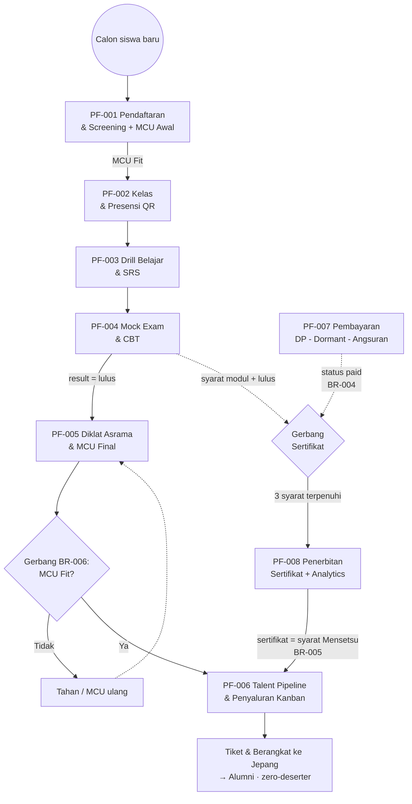
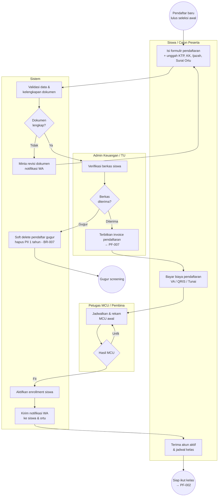
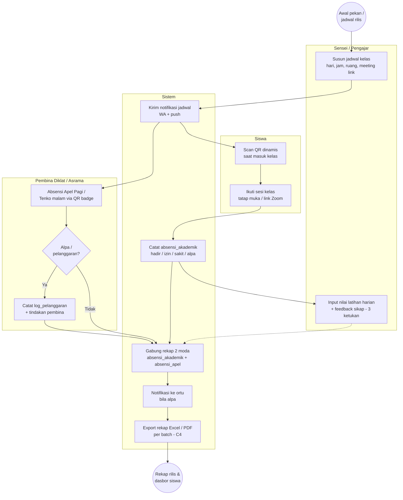
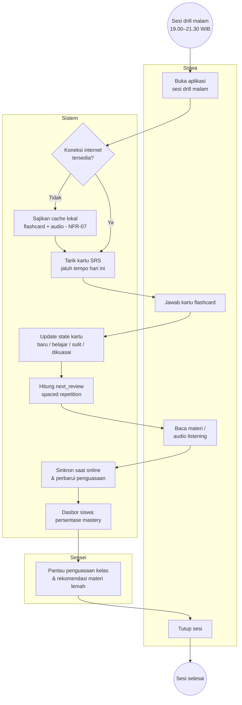
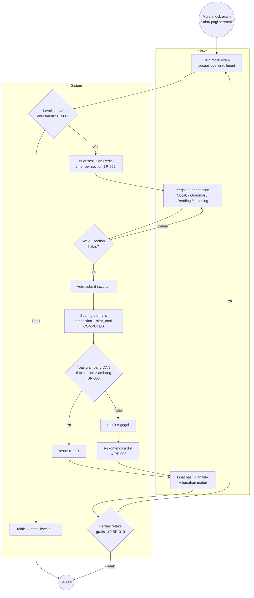
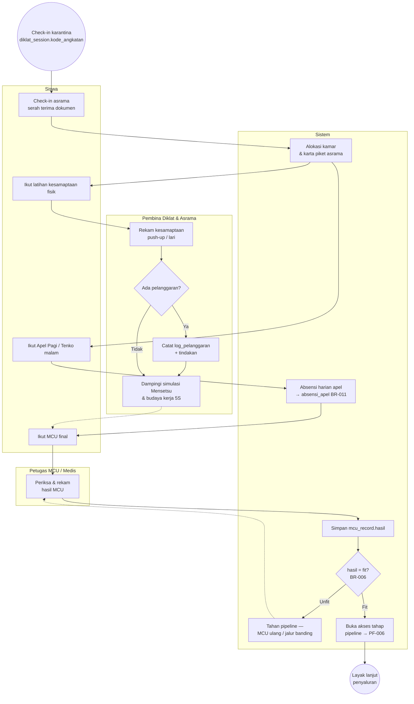
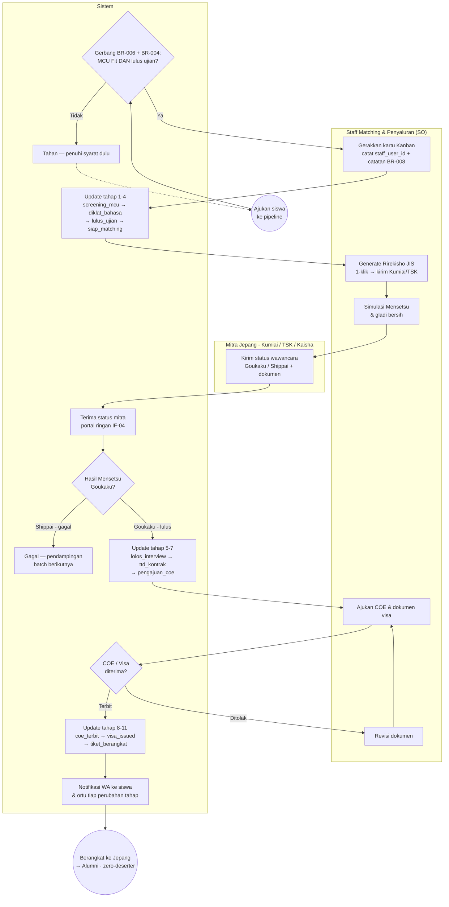
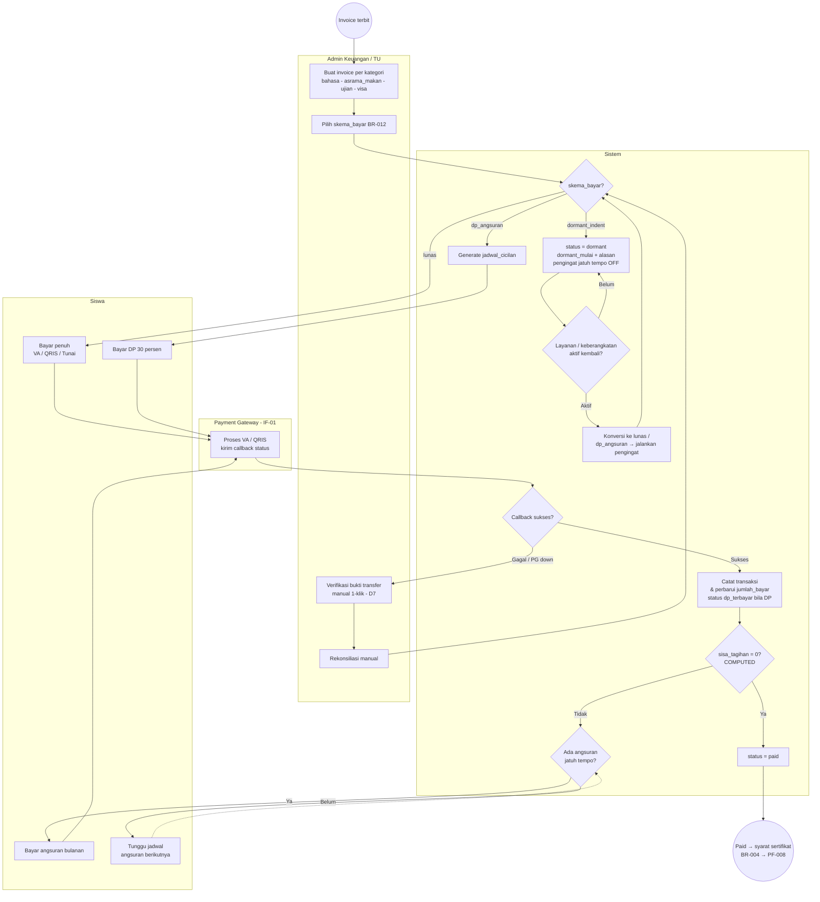
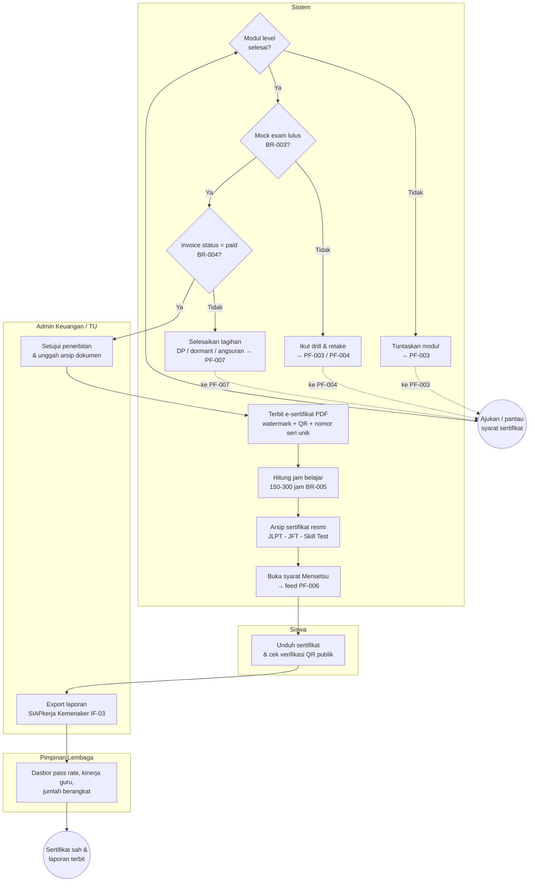

# Process Flows — Master (Lintas Chapter)

> **Notasi proyek (GLOBAL-00):** lihat [`NOTATION.md`](NOTATION.md) —
> matriks keputusan notasi per jenis informasi. Diagram per proses mengikuti
> notasi yang dipilih di sana.
>
> **Proyek:** JLPT Academy — LPK & Sending Organization (SO)
> **Format:** `PROCESS-FLOW-MASTER-FORMAT.md` (index + relationship map + proses lintas modul)
> **Notasi alur:** **BPMN → Mermaid (wajib)** — dirender `flowchart` dengan **`subgraph` = swimlane per aktor**, node belah ketupat `{}` = gateway keputusan, panah putus-putus = alur exception/rujukan lintas proses.
> **Versi:** 0.3 — PF-001..008 BPMN terisi (peta alur sementara di master)

Sistem ini satu perjalanan besar calon tenaga kerja Indonesia: **daftar → belajar & uji → karantina & MCU → penyaluran ke Jepang**, dipotong lintas modul oleh dua gerbang keras: **keuangan (bayar)** dan **kelayakan (MCU/ujian)**. Chapter BAB-1..8 mengelola masing-masing prosesnya; koneksi antar-chapter (gerbang BR-004 & BR-006) dipegang di sini.

---

## Index Proses

| ID | Proses | Chapter | Trigger | UC Terkait | Detail |
|----|--------|---------|---------|------------|--------|
| PF-001 | Alur Pendaftaran & Screening Siswa (MCU) | BAB-1-Data-Master-Siswa | Calon siswa baru lolos seleksi awal (BKK / rekomendasi alumni) | UC-001 | [`#pf-001`](#pf-001) 🟨 draft di master |
| PF-002 | Alur Kelas & Presensi Diklat (QR) | BAB-2-Kelas-Presensi-Diklat | Jadwal kelas/apel rilis | UC-002 | [`#pf-002`](#pf-002) 🟨 draft di master |
| PF-003 | Alur Drill Belajar & SRS | BAB-3-Engine-Belajar-SRS | Siswa buka app / kartu SRS jatuh tempo | UC-003 | [`#pf-003`](#pf-003) 🟨 draft di master |
| PF-004 | Alur Mock Exam & CBT (timer + scoring) | BAB-4-Mock-Exam-CBT | Siswa memulai mock exam | UC-004 | [`#pf-004`](#pf-004) 🟨 draft di master |
| PF-005 | Alur Diklat Asrama & MCU | BAB-5-Diklat-Asrama-MCU | Siswa check-in karantina / jadwal MCU | UC-005 | [`#pf-005`](#pf-005) 🟨 draft di master |
| PF-006 | Alur Talent Pipeline & Penyaluran (Kanban) | BAB-6-Talent-Pipeline-Penyaluran | Gerbang kelayakan terpenuhi + kabar mitra Jepang | UC-006 | [`#pf-006`](#pf-006) 🟨 draft di master |
| PF-007 | Alur Pembayaran & Cicilan (DP·Dormant·Angsuran) | BAB-7-Keuangan-Cicilan | Invoice terbit | UC-007 | [`#pf-007`](#pf-007) 🟨 draft di master |
| PF-008 | Alur Penerbitan Sertifikat | BAB-8-Sertifikasi-Analytics | Tiga syarat BR-004 terpenuhi | UC-008 | [`#pf-008`](#pf-008) 🟨 draft di master |

> **Status 🟨:** diagram per PF **masih ditampung di master** karena folder `BAB-{N}-*/PROCESS-FLOW.md` **belum digarap**. Saat chapter dibuat, diagram pindah ke file chapter (per format: master = index + proses lintas modul saja) dan kolom Detail diganti jadi `../BAB-{N}-*/PROCESS-FLOW.md#pf-xxx`.

---

## Process Relationship Map

```
PF-001 (Pendaftaran+MCU)  --triggers-->   PF-002 (Kelas & Presensi)
PF-002                    --triggers-->   PF-003 (Drill & SRS)
PF-003                    --triggers-->   PF-004 (Mock Exam & CBT)
PF-004                    --depends-on--> PF-005 (syarat lulus ujian masuk diklat)
PF-005                    --gates-->      PF-006 (MCU Fit = BR-006)
PF-006                    --escalates-to--> PF-008 (sertifikat = syarat Mensetsu, BR-005)
PF-007 (Pembayaran)       --gates-->      PF-008 (lunas = BR-004)
PF-007                    --escalates-to--> PF-001 (biaya pendaftaran)
```

### Peta Alur End-to-End (BPMN — lintas semua chapter)



---

## BPMN per Proses (DRAFT PETA ALUR)

> ⚠️ **Catatan migrasi:** section ini diisi lebih dulu supaya ada peta alur sebelum chapter digarap. Saat `BAB-{N}-*/PROCESS-FLOW.md` dibuat, tiap diagram **dipindah ke chapter-nya masing-masing** dan di sini tinggal rujukan.

<a id="pf-001"></a>
### PF-001: Alur Pendaftaran & Screening Siswa (MCU)

Menerima calon siswa baru sampai dinyatakan layak masuk kelas — memverifikasi berkas, menagih biaya pendaftaran, dan menyaring kelayakan fisik lewat MCU awal.

**Trigger:** Pendaftar baru lolos seleksi awal (BKK SMK / rekomendasi alumni / ads).
**Goal:** Siswa terdaftar, berkas terverifikasi, pendaftaran terbayar, dan **MCU awal = Fit**.

**Actors:**
- **Siswa/Calon:** isi formulir, unggah dokumen, bayar, terima notifikasi.
- **Admin Keuangan/TU:** verifikasi berkas, terbitkan invoice.
- **Petugas MCU/Pembina:** jadwalkan & rekam hasil MCU.
- **Sistem:** validasi, aktivasi enrollment, kirim notifikasi WA.



**Step Descriptions**

| Step | Actor | Action | System Response |
|------|-------|--------|-----------------|
| 1 | Siswa | Isi formulir + unggah dokumen | Validasi kelengkapan |
| 2 | Admin | Verifikasi berkas | Cacat diterima/ditolak |
| 3 | Sistem | Pendaftar gugur | Soft delete + hapus PII 1 thn (BR-007) |
| 4 | Admin | Terbitkan invoice | Memicu PF-007 |
| 5 | Siswa | Bayar pendaftaran | Cek status transaksi |
| 6 | Petugas MCU | Rekam MCU awal | Simpan hasil |
| 7 | Sistem | MCU Fit | Aktifkan enrollment + notifikasi WA |

**Decision Points**

| Step | Condition | True Path | False Path |
|------|-----------|-----------|------------|
| G1 | Dokumen lengkap | Verifikasi admin | Minta revisi |
| G2 | Berkas diterima | Terbitkan invoice | Soft delete (BR-007) |
| G3 | Hasil MCU | Fit → enrollment aktif | Unfit → MCU ulang |

**Exception Handling**

| Step | Exception | System Response | Recovery |
|------|-----------|-----------------|----------|
| S2 | Payment gateway down | Fallback unggah bukti transfer (IF-01, D7) | Verifikasi 1-klik admin |
| G3 | MCU Unfit | Tahan aktivasi | MCU ulang / pendampingan medis |
| G2 | Dokumen tidak valid | Soft delete + hapus PII (BR-007) | Pendaftaran ulang |

---

<a id="pf-002"></a>
### PF-002: Alur Kelas & Presensi Diklat (QR)

Dua moda kehadiran sekaligus — **absensi akademik** (per kelas) dan **absensi karantina** (Apel Pagi/Tenko) — wajib terpisah sesuai BR-011.

**Trigger:** Jadwal kelas/apel rilis.
**Goal:** Kehadiran, nilai harian, dan log kedisiplinan tercatat tanpa buku manual.

**Actors:**
- **Sensei:** susun jadwal, input nilai & feedback (< 3 ketukan).
- **Pembina:** absensi apel/Tenko, catat pelanggaran.
- **Siswa:** scan QR, ikuti sesi.
- **Sistem:** catat absensi, rekap, notif ortu, export.



**Step Descriptions**

| Step | Actor | Action | System Response |
|------|-------|--------|-----------------|
| 1 | Sensei | Susun jadwal | Notifikasi jadwal (WA + push) |
| 2 | Siswa | Scan QR masuk kelas | Catat `absensi_akademik` |
| 3 | Pembina | Absensi apel/Tenko | Catat `absensi_apel` (BR-011) |
| 4 | Sensei | Input nilai + feedback | Tersimpan < 3 ketukan |
| 5 | Pembina | Catat pelanggaran | Log + tindakan |
| 6 | Sistem | Rekap 2 moda | Notif ortu + export Excel/PDF |

**Decision Points**

| Step | Condition | True Path | False Path |
|------|-----------|-----------|------------|
| G1 | Alpa/pelanggaran terjadi | Log pelanggaran + tindakan | Langsung rekap |

**Exception Handling**

| Step | Exception | System Response | Recovery |
|------|-----------|-----------------|----------|
| I1 | QR tidak ter-scan (sinyal) | Input manual pembina (IF-06) | Sinkron saat online |
| E2 | Sensei senior resisten form rumit | Input super kilat < 3 ketukan (C10) | Pelatihan singkat |

---

<a id="pf-003"></a>
### PF-003: Alur Drill Belajar & SRS

Sesi drill mandiri (puncak 19.00–21.30 WIB) berbasis **Spaced Repetition** — tetap jalan saat kuota habis lewat cache lokal.

**Trigger:** Siswa membuka app / kartu SRS jatuh tempo (`next_review`).
**Goal:** Penguasaan kanji & kosakata naik, materi lemah terdeteksi.

**Actors:**
- **Siswa:** kerjakan kartu, baca materi, dengar audio.
- **Sistem:** tarik kartu jatuh tempo, hitung jadwal review, sinkron offline.
- **Sensei:** pantau penguasaan kelas & materi lemah.



**Step Descriptions**

| Step | Actor | Action | System Response |
|------|-------|--------|-----------------|
| 1 | Siswa | Buka aplikasi | Cek koneksi |
| 2 | Sistem | Offline | Sajikan cache lokal (NFR-07) |
| 3 | Sistem | Kartu jatuh tempo | Tarik dari antrean SRS |
| 4 | Siswa | Jawab kartu | Update state + jadwal review |
| 5 | Siswa | Baca/dengar materi | Sinkron saat online |
| 6 | Sensei | Pantau kelas | Rekomendasi materi lemah |

**Decision Points**

| Step | Condition | True Path | False Path |
|------|-----------|-----------|------------|
| G1 | Online? | Data dari server | Cache lokal lalu sinkron |

**Exception Handling**

| Step | Exception | System Response | Recovery |
|------|-----------|-----------------|----------|
| Y2 | Cache kosong/expired | Materi terakhir tersinkron | Sinkron otomatis saat online |

---

<a id="pf-004"></a>
### PF-004: Alur Mock Exam & CBT (timer + scoring)

Mock exam mengunci **level enrollment (BR-001)**, jalan dengan **timer per section (BR-002)**, dan menilai **total + sectional (BR-003)**. Format dibedakan: JLPT = section kertas, JFT = CBT.

**Trigger:** Siswa memulai mock exam.
**Goal:** Skor valid meniru ujian resmi + analitik kelemahan.

**Actors:**
- **Siswa:** pilih level, kerjakan ujian, lihat hasil.
- **Sistem:** validasi level, timer, auto-submit, scoring, rekomendasi.



**Step Descriptions**

| Step | Actor | Action | System Response |
|------|-------|--------|-----------------|
| 1 | Siswa | Pilih mock exam | Validasi level = enrollment (BR-001) |
| 2 | Sistem | Mulai sesi | Timer per section + session Redis |
| 3 | Siswa | Kerjakan section | Auto-submit saat habis (BR-002) |
| 4 | Sistem | Selesai | Scoring total + per section (BR-003) |
| 5 | Sistem | Lulus/gagal | Analitik kelemahan + rekomendasi drill |
| 6 | Siswa | Gagal | Retake gratis 1x (BR-010) |

**Decision Points**

| Step | Condition | True Path | False Path |
|------|-----------|-----------|------------|
| G1 | Level = enrollment | Mulai ujian | Tolak (BR-001) |
| G2 | Timer habis | Auto-submit | Lanjut mengerjakan |
| G3 | Total ≥ ambang DAN tiap section ≥ ambang | Lulus | Gagal (BR-003) |
| G4 | Gagal & belum pakai retake | Ulang gratis 1x | Selesai |

**Exception Handling**

| Step | Exception | System Response | Recovery |
|------|-----------|-----------------|----------|
| S2 | Koneksi putus saat ujian | Session Redis + jawaban lokal bertahan | Lanjut / sinkron |
| G2 | Timer habis | Submit paksa otomatis | Nilai dari jawaban terkirim |

---

<a id="pf-005"></a>
### PF-005: Alur Diklat Asrama & MCU

Fase karantina 100% tatap muka: kedisiplinan harian (apel/piket), kesamaptaan fisik, dan **MCU final** yang jadi gerbang pipeline.

**Trigger:** Siswa check-in asrama / jadwal MCU final.
**Goal:** Siswa dinyatakan **Fit** dan siap masuk penyaluran.

**Actors:**
- **Siswa:** check-in asrama, apel, latihan fisik, MCU.
- **Pembina:** rekam kesamaptaan, log pelanggaran, simulasi Mensetsu.
- **Petugas MCU/Medis:** periksa & rekam hasil MCU.
- **Sistem:** alokasi kamar, absensi, gerbang BR-006.



**Step Descriptions**

| Step | Actor | Action | System Response |
|------|-------|--------|-----------------|
| 1 | Siswa | Check-in asrama | Alokasi kamar + piket |
| 2 | Siswa | Apel pagi/Tenko | Catat `absensi_apel` (BR-011) |
| 3 | Pembina | Rekam kesamaptaan | Simpan catatan fisik |
| 4 | Pembina | Pelanggaran | Log + tindakan |
| 5 | Petugas MCU | MCU final | Simpan `mcu_record.hasil` |
| 6 | Sistem | Hasil Fit | Buka akses pipeline (BR-006) |

**Decision Points**

| Step | Condition | True Path | False Path |
|------|-----------|-----------|------------|
| G1 | Pelanggaran terjadi | Log + tindakan pembina | Lanjut simulasi/MCU |
| G2 | MCU = Fit | Buka pipeline (BR-006) | Tahan + MCU ulang |

**Exception Handling**

| Step | Exception | System Response | Recovery |
|------|-----------|-----------------|----------|
| G2 | Unfit tapi siswa ingin lanjut | Pipeline terkunci | Jalur banding / MCU ulang — *belum didefinisikan eksplisit* |

---

<a id="pf-006"></a>
### PF-006: Alur Talent Pipeline & Penyaluran (Kanban)

Kanban **11 tahap**: `screening_mcu → diklat_bahasa → lulus_ujian → siap_matching → panggilan_mensetsu → lolos_interview → ttd_kontrak → pengajuan_coe → coe_terbit → visa_issued → tiket_berangkat`. Tiap perpindahan wajib ter-audit (BR-008).

**Trigger:** Gerbang kelayakan terpenuhi + kabar dari mitra Jepang.
**Goal:** Siswa berangkat, gagal wawancara < 5%, jejak audit penuh (zero-deserter).

**Actors:**
- **Staff SO:** gerakkan Kanban, generate Rirekisho, kelola COE/visa.
- **Kumiai/TSK/Kaisha:** status wawancara (*Goukaku*) & dokumen (IF-04).
- **Sistem:** gerbang kelayakan, audit trail, notifikasi WA.



**Step Descriptions**

| Step | Actor | Action | System Response |
|------|-------|--------|-----------------|
| 1 | Sistem | Cek gerbang | MCU Fit + lulus ujian (BR-006) |
| 2 | Staff SO | Pindahkan kartu Kanban | Audit trail: `staff_user_id`, tanggal, catatan (BR-008) |
| 3 | Staff SO | Generate Rirekisho | Ekspor CV JIS 1-klik → mitra |
| 4 | Mitra | Kirim hasil Mensetsu | Sinkron status (IF-04) |
| 5 | Staff SO | Ajukan COE/visa | Update tahap pipeline |
| 6 | Sistem | Tahap final | Notifikasi WA + tiket berangkat |

**Decision Points**

| Step | Condition | True Path | False Path |
|------|-----------|-----------|------------|
| G1 | MCU Fit + lulus ujian | Buka pipeline (BR-006) | Tahan |
| G2 | Mensetsu Goukaku | Lanjut kontrak | Gagal → pendampingan batch berikutnya |
| G3 | COE/visa diterima | Lanjut berangkat | Revisi & ajuk ulang |

**Exception Handling**

| Step | Exception | System Response | Recovery |
|------|-----------|-----------------|----------|
| K1 | Mitra tidak kirim status | Input manual Staff SO (IF-04) | Eskalasi ke Kumiai/TSK |
| G3 | COE ditolak | Cacat dokumen, jalur revisi | Ajukan ulang |
| — | Siswa kabur (deserter) | Flag risiko + audit trail penuh (BR-008) | Prosedur zero-deserter |

---

<a id="pf-007"></a>
### PF-007: Alur Pembayaran & Cicilan (DP · Dormant · Angsuran)

Proses lintas-chapter (BAB-7 ↔ BAB-8) dengan **tiga skema wajib BR-012**: `lunas`, `dp_angsuran`, `dormant_indent`.

**Trigger:** Admin menerbitkan invoice per kategori.
**Goal:** Tagihan terbayar lunas (`status='paid'`) — prasyarat sertifikat BR-004.

**Actors:**
- **Admin Keuangan/TU:** terbitkan invoice, pilih skema, verifikasi bukti manual, rekonsiliasi.
- **Siswa:** bayar lunas / DP / angsuran.
- **Payment Gateway (IF-01):** VA/QRIS callback.
- **Sistem:** jadwal cicilan, status, pengingat, kalkulasi `sisa_tagihan`.



**Step Descriptions**

| Step | Actor | Action | System Response |
|------|-------|--------|-----------------|
| 1 | Admin | Buat invoice per kategori | Simpan `invoice` |
| 2 | Admin | Pilih skema bayar | Rute: lunas / dp / dormant (BR-012) |
| 3 | Siswa | Bayar DP → lunas / angsuran | Callback PG → catat `transaksi` |
| 4 | PG down | Siswa unggah bukti manual | Verifikasi 1-klik admin (D7) |
| 5 | Sistem | Hitung `sisa_tagihan` | COMPUTED = total − bayar |
| 6 | Sistem | sisa = 0 | `status = paid` → buka gerbang sertifikat |
| 7 | Sistem | Dormant | Tahan tagihan, pengingat OFF |

**Decision Points**

| Step | Condition | True Path | False Path |
|------|-----------|-----------|------------|
| G1 | Skema dipilih | Rute sesuai skema | — |
| G2 | Callback sukses | Catat transaksi | Fallback bukti manual (D7) |
| G3 | sisa_tagihan = 0 | paid | Cek jadwal cicilan |
| G4 | Angsuran jatuh tempo | Bayar angsuran | Tunggu jadwal |
| G5 | Layanan aktif kembali | Konversi skema | Tetap dormant |

**Exception Handling**

| Step | Exception | System Response | Recovery |
|------|-----------|-----------------|----------|
| PG1 | Payment gateway down | Fallback manual (IF-01/D7) | Verifikasi 1-klik admin |
| G4 | Angsuran terlambat | Status `terlambat` + pengingat WA | Tindakan kolektif admin |
| Y4 | Dormant tanpa batas | Tagihan ditahan tanpa denda | Konversi saat layanan buka |

---

<a id="pf-008"></a>
### PF-008: Alur Penerbitan Sertifikat

Gerbang **tiga syarat serentak (BR-004)**: modul selesai + mock lulus + biaya lunas → e-sertifikat ber-QR → syarat Mensetsu (BR-005) → analytics.

**Trigger:** Siswa mengajukan / menunggu sertifikat level.
**Goal:** Sertifikat sah terbit + laporan pass rate.

**Actors:**
- **Admin Keuangan/TU:** setujui, unggah arsip, export SIAPkerja.
- **Sistem:** cek 3 syarat, terbit QR, hitung jam belajar.
- **Siswa:** unduh & verifikasi QR.
- **Pimpinan:** dasbor analitik.



**Step Descriptions**

| Step | Actor | Action | System Response |
|------|-------|--------|-----------------|
| 1 | Sistem | Cek 3 syarat | Modul + mock lulus + paid (BR-004) |
| 2 | Admin | Setujui & unggah arsip | Legitimasi penerbitan |
| 3 | Sistem | Terbit sertifikat | PDF watermark + QR + nomor seri UNIQUE |
| 4 | Sistem | Hitung jam belajar | 150–300 jam = syarat Mensetsu (BR-005) |
| 5 | Siswa | Unduh & verifikasi QR | Cek laman verifikasi publik |
| 6 | Admin | Export SIAPkerja | Laporan regulator (IF-03) |
| 7 | Pimpinan | Dasbor | Pass rate, kinerja guru, jumlah berangkat |

**Decision Points**

| Step | Condition | True Path | False Path |
|------|-----------|-----------|------------|
| G1 | Modul selesai | Cek syarat berikut | Tuntaskan modul (PF-003) |
| G2 | Mock lulus | Cek pembayaran | Retake 1x (BR-010) |
| G3 | invoice = paid | Terbit sertifikat | Bayar dulu — DP/cicilan **belum cukup** |

**Exception Handling**

| Step | Exception | System Response | Recovery |
|------|-----------|-----------------|----------|
| G3 | DP/cicilan berjalan | Sertifikat **ditahan** (BR-004) | Lunasi sisa tagihan |
| Y1 | Nomor seri bentrok | Validasi UNIQUE | Regenerasi nomor |

---

## Alur Lintas Modul Kunci (dari business-rules)

- **MCU Fit → Pipeline:** `mcu_record.hasil='fit'` jadi gerbang `pipeline_status.tahap` (BR-006) — **BAB-5 ↔ BAB-6**.
- **Bayar Lunas → Sertifikat:** `invoice.status='paid'` jadi syarat `sertifikat` terbit (BR-004) — **BAB-7 ↔ BAB-8**.
- **Mock Lulus → Diklat:** `mock_exam.result='lulus'` prasyarat masuk diklat karantina — **BAB-4 ↔ BAB-5**.
- **Sertifikat → Mensetsu:** `sertifikat.jam_belajar` 150–300 jam = syarat wawancara (BR-005) — **BAB-8 ↔ BAB-6**.

---

## Open Questions / Trade-off

1. ~~Seluruh PF masih **TBD**~~ → **PF-001..008 sudah berupa draft BPMN (dengan swimlane) di master ini**; tinggal **migrasi** ke `BAB-*/PROCESS-FLOW.md` saat chapter digarap.
2. **MCU Unfit tapi ingin lanjut (PF-005)** — jalur banding/MCU ulang belum didefinisikan eksplisit di `business-rules.md`.
3. **PF-006 gagal Mensetsu** — hanya "pendampingan batch berikutnya", atau ada jalur *rematching* ke Kumiai lain? Belum diputuskan.
4. **PF-007 dormant tanpa batas** — perlu periode maksimum dormant sebelum invoice dianggap batal?
5. **PF-001 urutan bayar vs MCU** — saat ini bayar pendaftaran dulu baru MCU; kalau ternyata MCU dilakukan sebelum bayar, urutan lane berubah.
6. Belum ada **AS-IS** (proses manual lembaga saat ini) — perlu observasi 1 hari di lokasi agar TO-BE akurat.
7. Urutan prioritas penggarapan PF mengikuti **Tahap 1→4 roadmap** (SRS §9).
