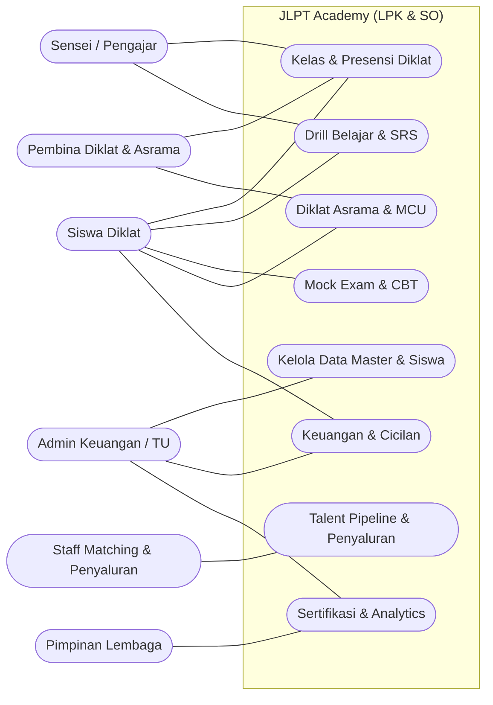

# SRS-MASTER: JLPT Academy — LPK & Sending Organization

> **Dokumen:** Sistem Requirements Specification — Master
> **Proyek:** JLPT Academy — Sistem Terintegrasi LPK & Sending Organization (SO) Jepang
> **Versi:** 0.2 (Sinkron dengan question-framework FINAL — 10 Okt 2026)
> **Status:** Jawaban bisnis FINAL dari owner; dokumen teknis menunggu audit lintas-dokumen (§5c)

---

## 1. Ringkasan Sistem

### 1.1 Nama & Tujuan
**JLPT Academy** adalah sistem terintegrasi **3-in-1** milik **LPK & Sending Organization (SO) berizin resmi** yang mengelola perjalanan penuh calon tenaga kerja Indonesia ke Jepang:

1. **LMS Drill Ujian** — persiapan bahasa Jepang (JLPT N5–N1 & JFT-Basic A2)
2. **ERP Diklat & Karantina Asrama** — kedisiplinan, pembinaan fisik, MCU
3. **Talent Pipeline & Penyaluran** — matching Kumiai/Kaisha, Rirekisho, COE, Visa, keberangkatan

### 1.2 Masalah yang Diselesaikan
- Pengelolaan siswa, kelas, ujian, pembayaran, asrama, dan status kerja masih terpisah/manual → data tercecer, audit Imigrasi & Kemenaker sulit.
- Siswa (mayoritas HP Android, literasi menengah–bawah) butuh belajar mandiri terstruktur di sela persiapan.
- Journey karir siswa (MCU → diklat → ujian → matching → COE → visa → berangkat) tidak terotomasi & transparan.
- Reputasi LPK bergantung pada **integritas penyaluran (zero-kabur/zero-deserter)** yang butuh bukti terdigitalisasi.

### 1.3 Ruang Lingkup (Scope)
**Termasuk:**
- **Data Master & Siswa**: akun 6 peran, profil siswa (termasuk MCU, kamar asrama), kelas, kamar.
- **Kelas & Presensi Diklat**: jadwal mengajar, presensi QR (akademik & apel karantina/Tenko), buku log kedisiplinan.
- **Engine Belajar & SRS Drill**: materi per level (Kanji/Kosakata/Bunpou/Choukai), flashcard Spaced Repetition, audio listening.
- **Mock Exam & CBT Engine**: bank soal 12 tipe, timer adaptif per section, scoring otomatis, analitik kelemahan.
- **Modul Diklat Asrama & MCU**: manajemen asrama, rekam kesamaptaan fisik, status MCU (Fit/Unfit).
- **Talent Pipeline & Penyaluran**: generator Rirekisho (JIS), Kanban status keberangkatan.
- **Keuangan & Cicilan**: invoice per kategori, payment gateway, dana talangan.
- **Sertifikasi & Analytics**: e-Sertifikat ber-QR, pass rate, laporan kinerja guru.

**Tidak termasuk (out of scope):**
- Pengurusan visa & dokumen imigrasi **secara langsung** (hanya tracking status & dokumen).
- Marketplace lowongan kerja mandiri (penyaluran terikat kemitraan Kumiai/TSK).
- Sistem akademik formal sekolah (SKPI, kurikulum SMK).

---

## 2. Tujuan Bisnis & Success Metrics

| ID | Tujuan Bisnis | Tipe | Metrik (baseline → target) | Penilai |
|----|---------------|------|----------------------------|---------|
| G1 | Meluluskan siswa yang lolos ujian bahasa | Service | Pass rate ujian bahasa → **≥ 85%** | Owner |
| G2 | Menyukseskan penyaluran kerja | Service | Siswa **berangkat kerja** → **200+ /tahun**; gagal wawancara/batal berangkat → **< 5%** | Owner + Staff SO |
| G3 | Pertumbuhan & skala lembaga | Revenue | Siswa aktif simultan → **300–500**, kapasitas scale ke **2.500+/tahun**; 4–6 batch/tahun | Owner |
| G4 | Integritas & reputasi (zero-kabur) | Intangible | **Zero-deserter**; akreditasi **A Kemenaker** | Owner |
| G5 | Efisiensi operasional | Revenue | Administrasi (absensi, tagihan, berkas) otomatis → waktu admin turun ≥ 50% | Admin Keuangan/TU |
| G6 | Kepatuhan regulasi | Legal | Insiden data pribadi = **0**; kepatuhan **UU PDP No. 27/2022** & legalitas LPK-SO Kemenaker | Owner |

---

## 3. Aktor & Peran

| Aktor | Deskripsi | Kemampuan Teknis | Kebutuhan Utama |
|-------|-----------|------------------|-----------------|
| **Siswa Diklat** | Calon magang/SSW, usia 18–30 | Menengah–bawah; dominan HP Android | Belajar/drill, pantau progress & tahapan dokumen, absensi QR, cek tagihan |
| **Sensei/Pengajar** | Mengajar bahasa & menyusun materi | Menengah; HP/laptop | Input kehadiran/nilai < 3 ketukan, kelola materi & bank soal |
| **Pembina Diklat & Asrama** | Fasilitator karantina & kedisiplinan | Menengah; HP | Absensi apel/Tenko, rekam kesamaptaan fisik, log pelanggaran |
| **Staff Matching & Penyaluran (SO)** | Mengelola matching & dokumen ke Jepang | Menengah–tinggi; laptop | Gerakkan Kanban pipeline, generate Rirekisho, kelola COE/visa |
| **Admin Keuangan/TU** | Kelola tagihan, pembayaran, berkas | Menengah–tinggi; laptop | Invoice per kategori, rekonsiliasi, verifikasi berkas |
| **Pimpinan Lembaga (Owner/Direktur)** | Pengambil keputusan strategis | Menengah; laporan | Dasbor analitik (pass rate, jumlah berangkat, kinerja) |
| **Sistem Eksternal (Kumiai/TSK/Kaisha)** | Mitra penempatan & pengawas di Jepang | — (via Staff SO) | Info status wawancara (*Goukaku*/tidak) & dokumen |

### 3.1 Use Case Diagram — Scope Aktor (Mermaid)

> **Catatan teknis notasi:** Mermaid **tidak punya tipe diagram `usecaseDiagram`** (diverifikasi di Mermaid v9 & v11 — keduanya menolak). Agar tetap **Mermaid** sesuai GLOBAL-00 (baris 5 matriks), Use Case digambar memakai `flowchart` dengan **`subgraph` = boundary sistem** dan node stadium = use case.

> `---` = asosiasi (bukan alur) — sesuai tujuan Use Case Diagram: **siapa bisa ngapain**, bukan urutan.

---

## 4. Fitur per Aktor (Ringkas)

### Siswa Diklat
- Belajar materi per level + flashcard SRS (kanji/kosakata) + audio listening (offline caching).
- Kerjakan mock exam/CBT (timer per section, auto-score, prediksi kelulusan).
- Absensi QR (kelas & apel/Tenko), lihat rekap absensi & log kedisiplinan.
- Pantau **tahapan dokumen keberangkatan** (MCU → ujian → matching → COE → visa → berangkat).
- Cek & bayar tagihan (VA/QRIS/tunai), ajukan dana talangan.
- Terima notifikasi WA & push (jadwal, apel, tagihan, panggilan wawancara).

### Sensei/Pengajar
- Input kehadiran, nilai latihan harian, feedback sikap (**< 3 ketukan**).
- Kelola materi (Kanji/Kosakata/Bunpou/Choukai) & bank soal via CMS terpisah.

### Pembina Diklat & Asrama
- Absensi apel pagi/malam (Tenko) via QR badge.
- Rekam kesamaptaan fisik (push-up/lari) & status MCU.
- Catat pelanggaran kedisiplinan + tindakan.

### Staff Matching & Penyaluran (SO)
- Gerakkan kartu Kanban pipeline siswa (Matching → Mensetsu → Kontrak → COE → Visa → Berangkat).
- Generate **Rirekisho** (CV standar JIS) 1-klik.
- Kelola data Kumiai/Kaisha & status dokumen.

### Admin Keuangan/TU
- Kelola tagihan per kategori (Bahasa, Asrama/Makan, Ujian, Visa), cicilan & dana talangan.
- Verifikasi berkas siswa (KTP, Ijazah, Surat Izin Ortu, MCU, Paspor).
- Rekonsiliasi payment gateway + fallback unggah bukti transfer manual.

### Pimpinan Lembaga
- Dasbor analitik: pass rate, jumlah berangkat, kinerja guru, utilisasi asrama.

---

## 5. Use Case Penting (Daftar — detail per chapter)

| UC ID | Nama | Aktor Utama | Chapter |
|-------|------|-------------|---------|
| UC-001 | Kelola Data Master & Siswa | AdminKeuangan | BAB-1 |
| UC-002 | Kelola Kelas & Presensi Diklat | Sensei/Pembina | BAB-2 |
| UC-003 | Drill Belajar & SRS | Siswa | BAB-3 |
| UC-004 | Kerjakan Mock Exam & CBT | Siswa | BAB-4 |
| UC-005 | Diklat Asrama & MCU | Pembina/Siswa | BAB-5 |
| UC-006 | Talent Pipeline & Penyaluran | StaffSO | BAB-6 |
| UC-007 | Keuangan & Cicilan | AdminKeuangan/Siswa | BAB-7 |
| UC-008 | Sertifikasi & Analytics | AdminKeuangan/Pimpinan | BAB-8 |

---

## 6. Interface / Sambungan ke Sistem Lain

| ID | Sistem Eksternal | Data | Cara | Kapan | Fallback saat gagal |
|----|------------------|------|------|-------|---------------------|
| IF-01 | **Payment Gateway (Midtrans/Xendit)** | VA bank (BCA/Mandiri/BNI/BRI), QRIS | API otomatis + rekonsiliasi | Saat siswa bayar | Unggah bukti transfer manual → verifikasi 1-klik admin kasir |
| IF-02 | **WhatsApp Official API Gateway** | Notifikasi siswa & orang tua | API otomatis | Terjadwal/event | Retry + push notification in-app |
| IF-03 | **SIAPkerja Kemenaker** | Data siswa/laporan | **Export format standar** | Saat diminta regulator | Export manual oleh admin |
| IF-04 | **Kumiai/TSK/Kaisha (Jepang)** | Status wawancara (*Goukaku*), dokumen | Portal ringan + auto-Rirekisho | Saat ada kabar Jepang | Input manual oleh Staff SO |
| IF-05 | **Zoom / Google Meet** | Link kelas & simulasi Mensetsu | Deep link | Sebelum sesi online | Admin share link manual |
| IF-06 | **QR Scanner (gerbang asrama/kelas)** | Kehadiran siswa | Dynamic QR di-scan HP/tablet | Saat apel/check-in | Input manual pembina |

---

## 7. Business Rules (Ringkas — detail di `business-rules.md`)

- **BR-001:** Siswa hanya bisa mengikuti mock exam untuk level pada enrollment-nya.
- **BR-002:** Mock exam menggunakan **timer adaptif per section** sesuai blueprint; submit otomatis saat waktu habis.
- **BR-003:** Nilai lulus mock = total ≥ ambang level DAN tiap section ≥ ambang sectional.
- **BR-004:** Sertifikat internal hanya terbit bila modul level selesai + mock lulus + **biaya lunas**.
- **BR-005:** Sertifikat internal = **syarat kelayakan Mensetsu** & bukti jam belajar (min. 150–300 jam).
- **BR-006:** Siswa wajib **MCU dinyatakan Fit** sebelum lanjut ke tahap matching/penyaluran.
- **BR-007:** Data pribadi wajib dienkripsi & bisa dihapus atas permintaan (**UU PDP**); peserta gugur screening → soft delete, data sensitif dihapus permanen setelah 1 tahun.
- **BR-008:** Perubahan tahap pipeline hanya oleh **Staff SO/Pembina**; setiap perpindahan Kanban wajib tercatat (audit).
- **BR-009:** Data siswa disimpan **10 tahun** (kepatuhan Kemenaker & audit Imigrasi).

---

## 8. Non-Functional Requirements (Ringkas — detail di `nfr.md`)

| ID | Tipe | Kebutuhan |
|----|------|-----------|
| NFR-01 | Performance | Buka flashcard/materi **< 1,5 dtk**; submit jawaban **< 500 ms**; streaming audio listening instan tanpa buffering |
| NFR-02 | Availability | **≥ 99%** akses (down maks ~7 jam/bulan) |
| NFR-03 | Scalability | Stabil **300–500 siswa simultan**, scale ke **2.500+/tahun**; mock exam serentak **100+ siswa** (Redis caching session) |
| NFR-04 | Security | **AES-256 at-rest** + **TLS 1.3 in-transit** untuk NIK, KTP/KK, Paspor, rekam medis (MCU), keuangan |
| NFR-05 | Compliance | **UU PDP No. 27/2022** + legalitas LPK-SO Ditjen Binalavotas Kemenaker |
| NFR-06 | Usability | UI simpel, ikonik, bebas jargon, tombol besar ramah jempol, teks kanji ber-**furigana** tajam |
| NFR-07 | Offline | Flashcard kanji/kosakata + audio materi aktif di-caching lokal |
| NFR-08 | Operasional | **Backup harian 02.00 WIB**, retensi 30 hari offsite, **RPO < 24 jam, RTO < 2 jam**; **cloud DC Region Jakarta** |
| NFR-09 | Maintenance | CMS bank soal & materi terpisah — guru konten update tanpa ganggu modul siswa |

---

## 9. Roadmap Rollout (dari question-framework F1–F8)

| Tahap | Modul | Isi |
|-------|-------|-----|
| **Tahap 1 — Fondasi Utama** | Data Master & Siswa · Kelas & Presensi Diklat | Akun 6 peran, profil siswa (MCU/kamar), jadwal, presensi QR, log kedisiplinan |
| **Tahap 2 — Akademik Siswa** | Engine Belajar & SRS · Mock Exam & CBT | Materi per level, flashcard SRS, bank soal 12 tipe, timer adaptif, analitik kelemahan |
| **Tahap 3 — Operasional Diklat** | Diklat Asrama & MCU · Talent Pipeline | Manajemen asrama, kesamaptaan fisik, MCU, Rirekisho, Kanban keberangkatan |
| **Tahap 4 — Komersial** | Keuangan & Cicilan · Sertifikasi & Analytics | Invoice, payment gateway, dana talangan, e-Sertifikat QR, dasbor pass rate |

---

## 10. Asumsi Terbuka & Trade-off

| # | Item | Status |
|---|------|--------|
| A1 | Stack teknologi: **Laravel/Livewire/Alpine** atau **Next.js/Tailwind** | **Ditunda (by design)** — sengaja dibiarkan kosong, dipilih tim in-house saat implementasi |
| A2 | Penyedia payment gateway: **Midtrans** vs **Xendit** | **Ditunda (by design)** — sengaja dibiarkan kosong, dipilih saat implementasi |
| A3 | Entitas **"Batch" (kelas)** vs **Diklat (karantina)** | **SELESAI — DIPISAH**: `kelas.nama_batch` (akademik) vs `diklat_session.kode_angkatan` (karantina); keduanya tetap ada sebagai skenario terpisah |
| A4 | Sumber **dana talangan** | **SELESAI — MULTI-SUMBER**: koperasi mitra, internal LPK, **donasi pemerintah**, mitra lain |

> **Catatan:** Jawaban bisnis (A–F) FINAL di `question-framework.md`. A1 & A2 **sengaja dibiarkan terbuka** (ditunda ke fase implementasi — keputusan owner). A3 & A4 sudah diputuskan & sudah diterapkan di `ERD-MASTER.md`.

---

## Open Questions / Trade-off
1. ~~Stack teknologi final~~ → **Ditunda (by design)** — belum dipilih, urusan tim in-house.
2. ~~Payment gateway final~~ → **Ditunda (by design)** — belum dipilih.
3. ~~Pemisahan entitas "batch" kelas vs diklat~~ → **SELESAI: DIPISAH** (`kelas.nama_batch` vs `diklat_session.kode_angkatan`).
4. ~~Mekanisme dana talangan~~ → **SELESAI: MULTI-SUMBER** (koperasi mitra, internal LPK, donasi pemerintah, mitra lain).
